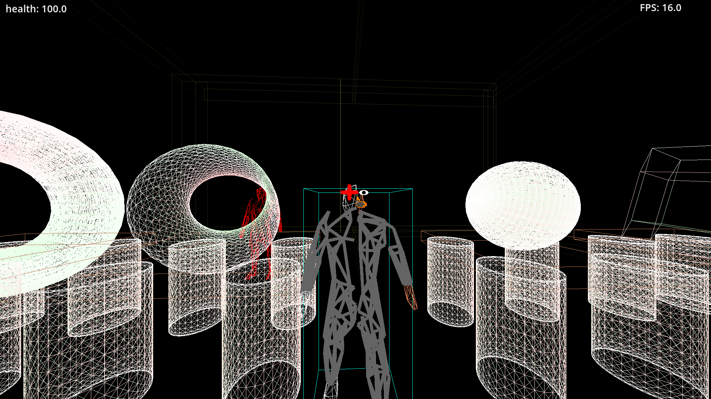
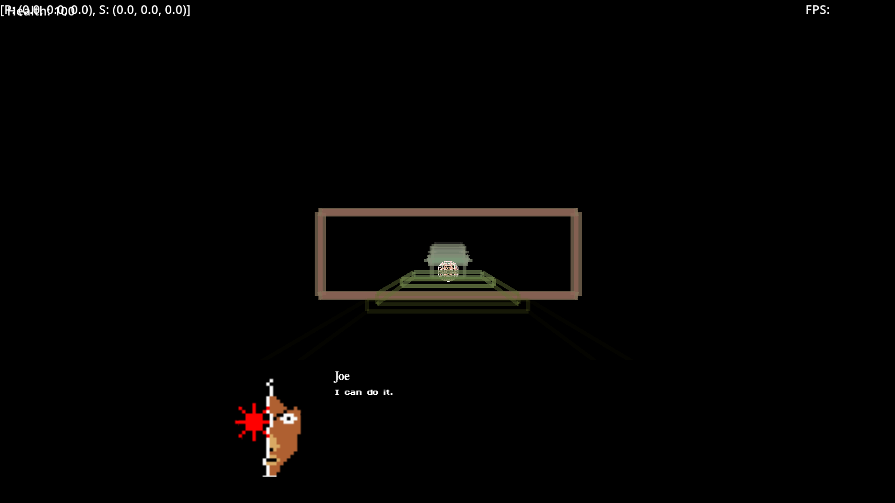
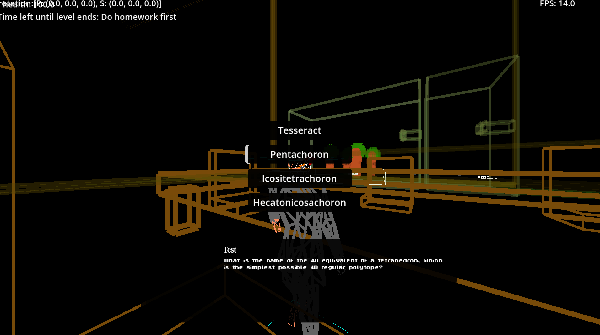
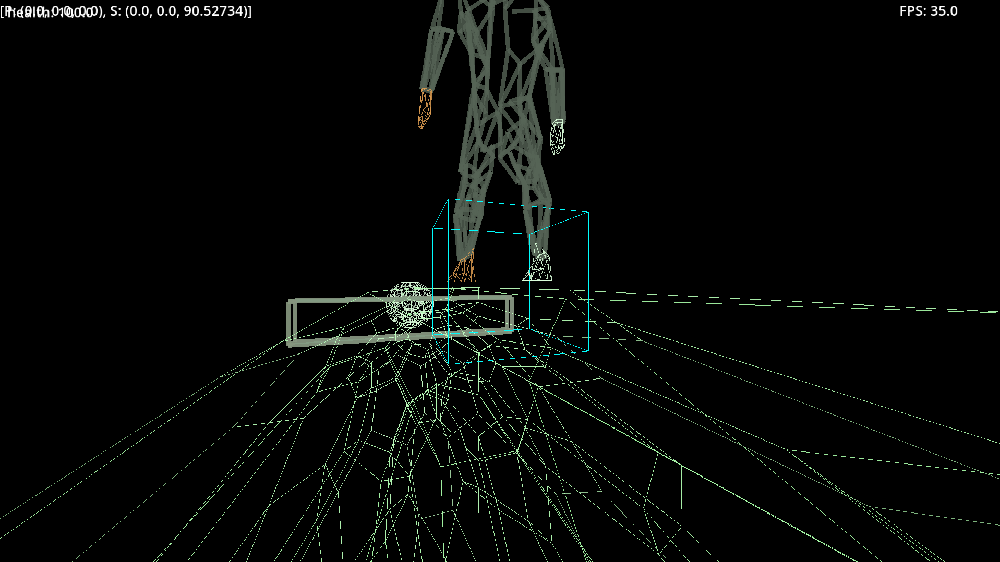
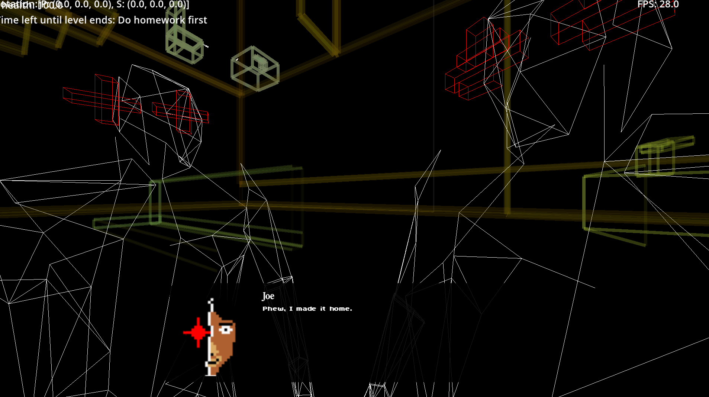
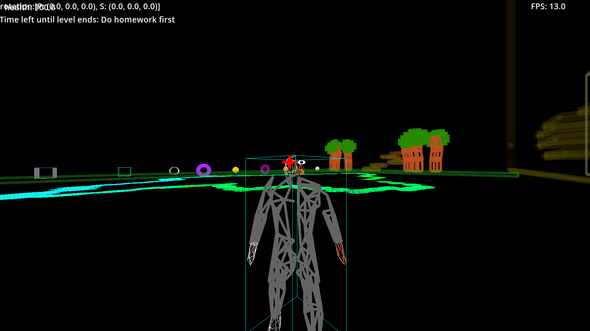

**<u>JOE CHAPTER 0 - THE PROLOUGUE</u>**

⚠️<u>Warning: This is still in heavy development, and lots of things
still might be unpolished. (I work on this after school, school slows
down development, I make this in my free time. I am only 12)</u>

**<u>You will need this specific fork of Godot:</u>
<https://github.com/godot-dimensions/godot-4d>**

**<u>Description:</u>**

You are a character called Joe. You are half-human and half-alien. You
try to get back to home. But something goes wrong… Explore the 4D
environments and learn how the forth-dimension works!

**Controls**

W,A,S,D,Q,E or (Left Joystick, L1, R1) – Movement

G or (Square) – Ground View

R, F, V, Z, X, C or (Left Joystick Press, L2, R2) – Rotate objects(Some
objects can be rotated)

B or (Right Joystick Press) – Reset object rotation

Left mouse button or (Left Joystick Press) – Attack

I or (Left Joystick Press) – Interact

Mouse or (Right Joystick) – Rotate Camera

Ctrl or (Circle) – Toggle Sprint(Disabled for some levels)

T – Lock or unlock mouse

F5 or (Triangle) – Toggle Third person

Space or (X) – Jump

**CHAPTER 1 – 10’s code will not be public and be paid**

**The reason why Chapter 0’s code is public is because I want to hide
secrets in code.**

**<u>Credits</u>**:

**<u>Inspiration:</u>**

**4D mechanics:**

**Codeparade: The reason why I wanted to make 4D games**

**Tessimal: The idea for ground view.**

**Storyline:**

**Wonderland.jar and otherworld Minecraft horror mods, Undertale and
Deltarune**

**<u>Assets</u>**:

**Undertale Asriel, Asgore, Toriel and Default voice.**

**4D models: <https://paulbourke.net/geometry/hyperspace/>**

**Low poly 3D human:
<https://www.printables.com/model/568791-human-low-poly/files>**

**<u>People:</u>**

**Ezra Goswami(ME) – Programmer, Owner of SGME**

**Joshua Goswami(My brother) – Controller Tester**
